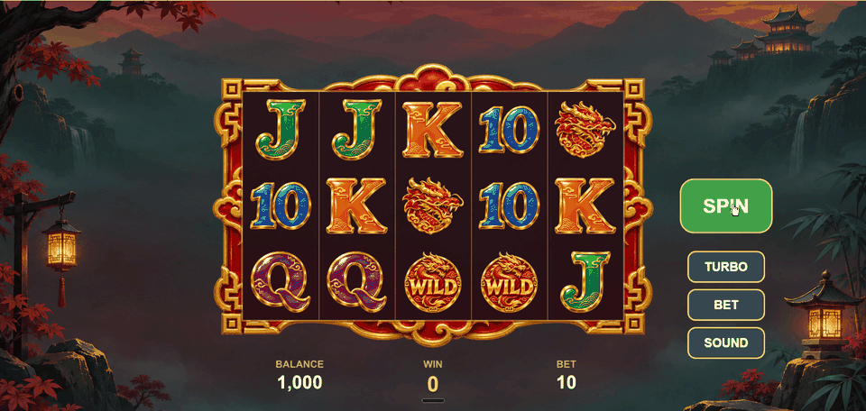

# Dragon Lanterns — slot demo

A 5×3 video slot client built with **PixiJS v8, TypeScript, Spine, GSAP and Vite**. Portfolio project.



## Features

- **Full game cycle:** bet → spin → staggered stop on the server grid → win presentation → balance update, driven by a small state machine (`idle → spinning → stopping → showWins → idle`).
- **Reels:** masked strip of pooled sprites (no allocations while spinning), one `offset` number per reel, GSAP landing with overshoot and bounce, quick stop (press Spin again), turbo preset.
- **Win presentation:** paylines drawn left to right on `Graphics`, winning symbols play a **Spine** animation (one skeleton, one skin per symbol), other symbols are dimmed, the background is darkened and blurred with filters; after that the lines cycle one by one until the next spin.
- **UI:** custom `Button` with normal / hover / pressed / disabled states, `BitmapText` balance / win / bet panel with a rolling win counter.
- **Sound:** `@pixi/sound` — spin loop, reel stop, win hit on a Spine event, background music, mute button.
- **Responsive:** landscape (1920×1080) and portrait (1240×2200) layouts, switched at runtime on resize.

## Controls

| Control | Action |
| --- | --- |
| **SPIN** | start a spin; while spinning — quick stop; during the win presentation — skip |
| **TURBO** | faster reels and win presentation |
| **BET** | next bet (10 / 20 / 50 / 100) |
| **SOUND** | mute / unmute |

## Run

```bash
npm install
npm run dev       # dev server
npm run build     # type check + production build to dist/
npm run preview   # serve the production build
npm run assets    # rebuild public/assets/ from art-src/
```

Requires Node.js 24. The build uses relative paths (`base: './'`), so `dist/` can be hosted from any subfolder (GitHub Pages, itch.io).

`npm run assets` packs the symbol atlas, generates the Spine atlas and skeleton for the symbols, and copies the background, frame, logo and sounds.

## Architecture

```
main.ts ─► Engine (Application, Assets, Navigation)
        ─► LoadScreen: logo + progress bar while the "game" bundle loads
        ─► GameScreen: builds the views and wires input ↔ controller ↔ model
                 │
      Button.onPress
                 ▼
           GameController ─► RgsClient.spin(bet) ─► MockRgs (grid, line wins, balance)
                 │
                 ├─► GameModel (balance, bet, win, state, turbo, mute) ── events ──► UI panel, buttons
                 └─► GameView (reels, win presenter, audio): setGrid / startSpin / stopOn / showWins
```

- **Screens instead of scenes:** PixiJS has no scene system, so `engine/Navigation` loads each screen's asset bundles, swaps screens and forwards `resize` / `update`.
- **Logic is Pixi-free:** `game/` (model, controller) and `server/` (RGS contract and mock) don't import `pixi.js`; the controller talks to the view through the `GameView` interface, animations return promises.
- **Server is the source of truth:** the client deducts the bet immediately, takes the final balance from the spin response and credits it after the win presentation.
- **One clock:** reels, GSAP and Spine are all updated from `app.ticker` (GSAP's own `requestAnimationFrame` is disabled, Spine runs with `autoUpdate: false`).
- **Configs, not magic numbers:** timings (normal / turbo presets), styles, layouts and audio live in `src/config/` and are injected into the views.
- **Spine without the editor:** the symbol skeleton is generated by `scripts/spine/symbolSpine.mjs` (Spine JSON 4.3) on top of the existing symbol atlas — sprites and Spine share one texture.

## Performance

Measured in Chrome (WebGL via ANGLE/D3D11, AMD Radeon), canvas 1920×912; CPU time of one `ticker.update` at a fixed 60 FPS step:

| State | CPU per frame, ms (avg / p95) | Draw calls (avg / max) |
| --- | --- | --- |
| idle | 0.36 / 0.6 | 7 / 7 |
| spinning | 0.58 / 1.0 | 7 / 7 |
| win presentation (Spine + lines + filters) | 1.7 / 2.9 | 24 / 34 |

The win presentation costs more because of the background filters (multi-pass blur) and the additive glow slot in the Spine symbols, which breaks batching while it is visible. In dev builds the app is exposed to the [PixiJS DevTools](https://pixijs.io/devtools/) extension.

## Project structure

```
src/
  main.ts      bootstrap
  engine/      Engine, Navigation, Screen interface, layout helpers
  config/      game shape, layouts, reel / win timings, UI styles, Spine, audio, asset manifest
  server/      RgsClient interface, game math (server-only), MockRgs
  game/        GameModel, GameController
  screens/     LoadScreen, GameScreen
  views/       reels/ (ReelsView, Reel), wins/ (lines, Spine symbols, backdrop, presenter), spine/, ui/
  audio/       GameAudio over @pixi/sound
art-src/       source art and sounds
scripts/       asset build: symbol atlas, Spine atlas and skeleton
```

## Tech

PixiJS 8.22 · @esotericsoftware/spine-pixi-v8 4.3 · @pixi/sound 6 · GSAP 3 · TypeScript · Vite

## Credits

Art was generated for this project with OpenAI ImageGen; see [art-src/LICENSE.md](art-src/LICENSE.md).
Sound effects and music are placeholders and will be replaced before publishing.
